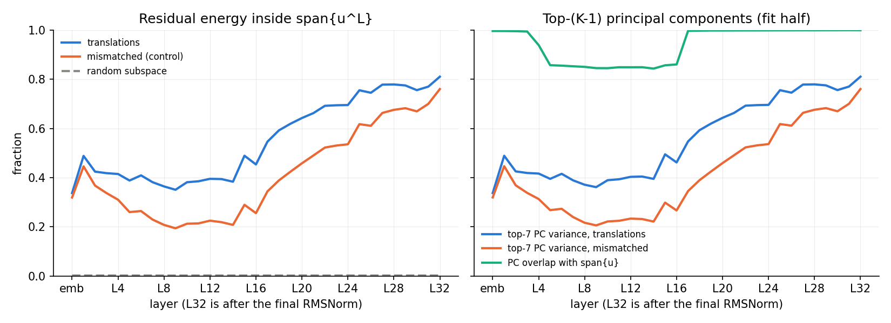

# T1 findings

This was a test checking mostly known phenomena. We confirm the following properties:
1. Early and middle layers (about L5–L16) of the LLM are more language-agnostic.
2. Principal Components computed with PCA on the differences between specific statement embeddings and the translation-mean are approximately the same as the overall precomputed language subspace.
3. Compared to a control where the statements in the differences have a different meaning, the language subspace accounts for a noticably smaller share of the variance, as expected.

| Layer | In language span | Mismatched control | Random 7-dim subspace |
|---|---|---|---|
| embeddings | 0.34 | 0.32 | 0.002 |
| L8 | 0.36 | 0.21 | 0.002 |
| L16 | 0.45 | 0.26 | 0.002 |
| L24 | 0.70 | 0.54 | 0.002 |
| L31 | 0.77 | 0.70 | 0.002 |

