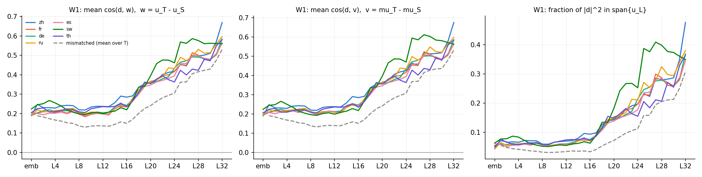
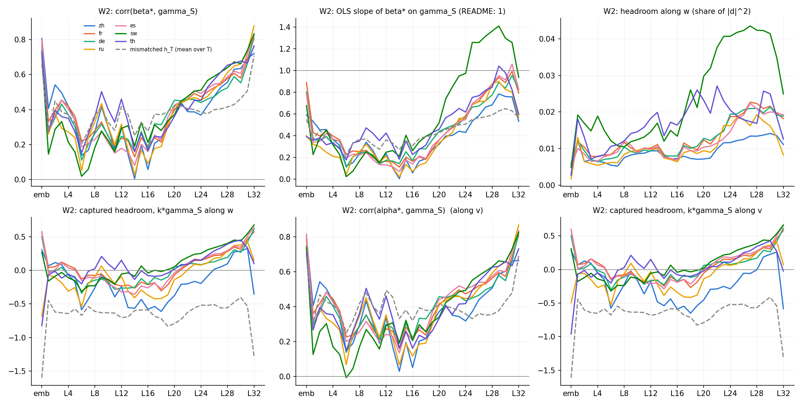

# Word-level findings (W1, W2)

English word vs. its aligned translation (SimAlign Argmax, 7 languages, test half); d = h_T - h_S. Results hold for clean-only words and mean pooling.

1. Translations share meaning: in middle layers cos(h_S - mu, h_T - mu) is about 0.6, against about 0.06 for a random word of the same type.
2. The rest of d is mostly not language: only about 7% of |d|^2 lies in the span of the global language directions in middle layers (about 30% in late layers), while d is almost as large as h_S - mu. The clean decomposition seen in T1 only appears after averaging over a sentence.
3. Per-token gamma does not help in middle layers: a per-word scale could remove only about 1-2% of |d|^2 beyond a constant shift. The correlation with gamma_S is no higher than for mismatched words, and k*gamma_S does worse than a constant.
4. In late layers (L24-L31) the README formula holds: the slope of beta* on gamma_S is about 1, and it captures 30-45% of that small headroom (mismatched words: about 0).

| Layer | cos(d, w) | in language span | headroom | captured by k*gamma_S | captured, mismatched |
|---|---|---|---|---|---|
| L8 | 0.21 | 0.06 | 0.010 | -0.13 | 0.05 |
| L16 | 0.24 | 0.07 | 0.009 | -0.25 | -0.04 |
| L24 | 0.42 | 0.20 | 0.020 | 0.10 | -0.02 |
| L31 | 0.54 | 0.32 | 0.020 | 0.44 | 0.06 |

